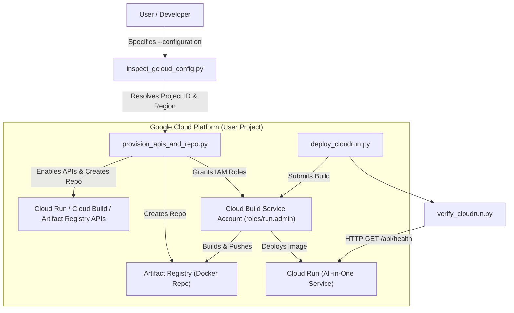
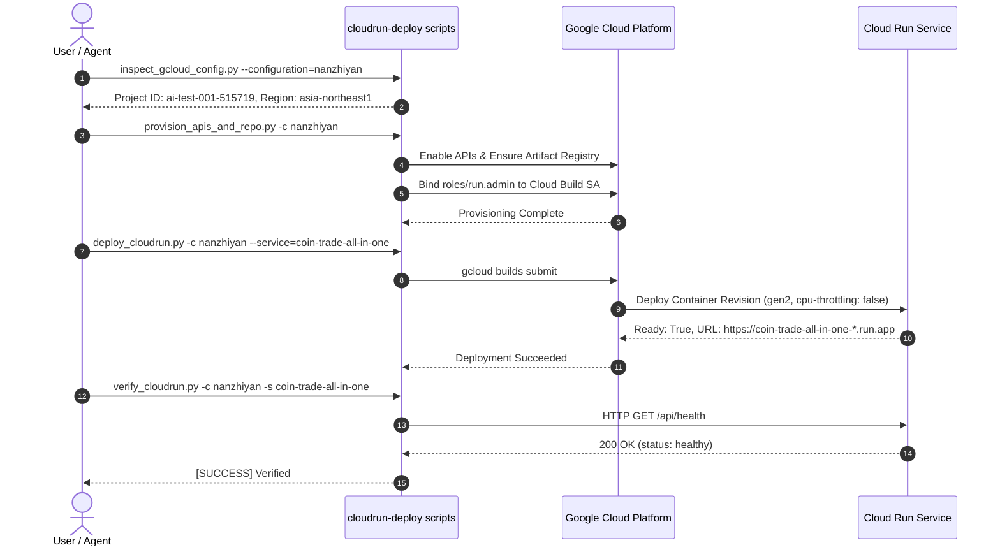

# cloudrun-deploy: Architecture & Technical Specification

## 1. System Architecture Diagram

## 2. Sequence Diagram

## 3. Required Environment & Deliverables

| Key | Description | Default |
|:---|:---|:---|
| `GCP_PROJECT_ID` | Google Cloud Project ID | Auto-resolved from `gcloud config` |
| `GCP_REGION` | Cloud Run / Artifact Registry region | `asia-northeast1` |
| `SERVICE_NAME` | Cloud Run service name | `coin-trade-all-in-one` |
| `ARTIFACT_REPO` | Artifact Registry repo name | `coin-trade-repo` |
