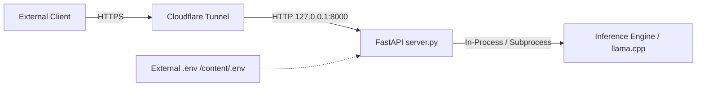
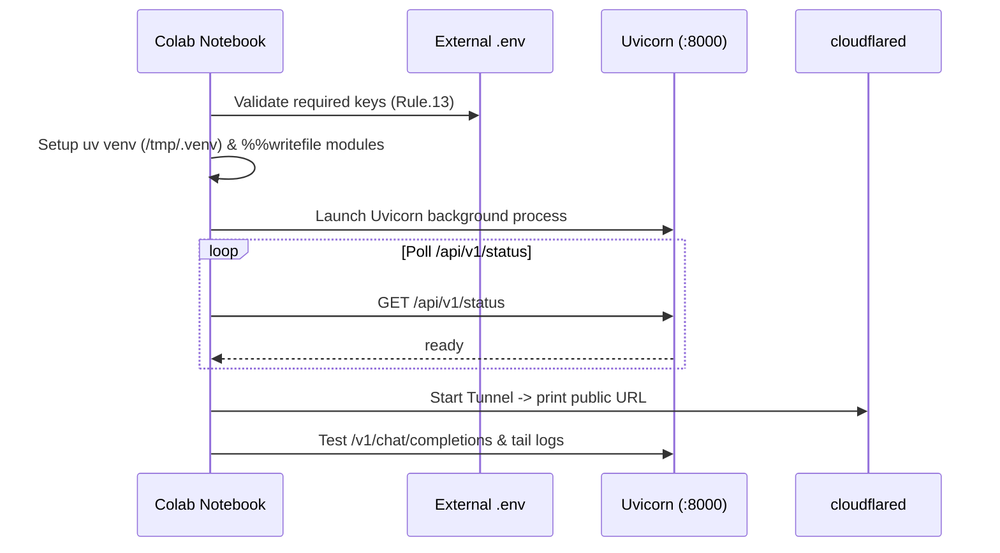

# Architecture & Specifications (`colab-notebook`)

## 1. Architecture Diagram

## 2. Sequence Diagram

## 3. Environment Variables, External Data & APIs
| Category | Name | Purpose |
|:---|:---|:---|
| **Env** | `TUNNEL_HOST`, `TUNNEL_PORT`, `TUNNEL_HOSTNAME`, `LLM_API_KEY`, `MODEL_NAME` | Server binding, Tunnel host, auth, model ID |
| **External Data** | `/content/.env`, Hugging Face model weights | External secrets and downloaded weights |
| **Public API** | `GET /healthz`, `GET /api/v1/status`, `GET /v1/models`, `POST /v1/chat/completions` | Health, status, OpenAI-compatible inference |

## 4. Deliverables
- `<name>_colab.ipynb`, `.env`, `.env.example`, `http.rest`, `README.html`
- Generated runtime modules (`core/{config,logger,state,engine}.py`, `routers/{health,status,chat,models}.py`, `server.py`)
