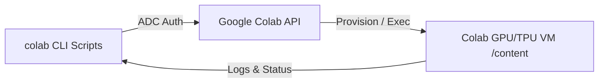
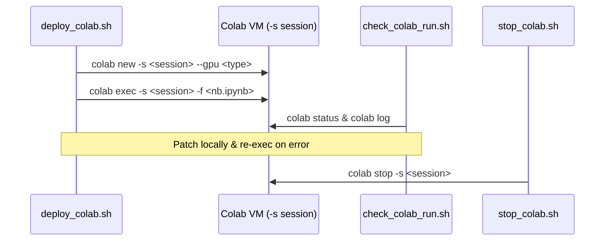

# Architecture & Specifications (`colab-operator`)

## 1. Architecture Diagram

## 2. Sequence Diagram

## 3. Environment Variables, External Data & APIs
| Category | Name | Purpose |
|:---|:---|:---|
| **Env / Auth** | Google ADC (`gcloud auth application-default login`) | Headless Colab API authentication |
| **External Data** | Local `.ipynb` / `.py`, `/content/.env` | Remote execution target and VM secrets |
| **External API** | Google Colab API (`new`, `exec`, `status`, `log`, `stop`) | VM lifecycle and kernel execution |

## 4. Deliverables
- Active/verified Colab session output and logs (`colab log -s <session>`)
- Verified `http.rest` inference results and clean session teardown
