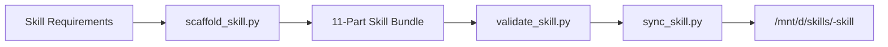
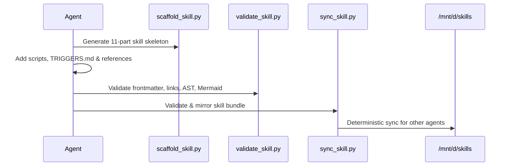

# Architecture & Specifications (`create-new-skill`)

> [!NOTE]
> プロジェクトの Rule.11（HTML-First ポリシー）はユーザー向け技術文書・報告書を対象としており、スキル内部の `references/` における軽量な構造把握では Mermaid 図解を標準採用しています。

## 1. Architecture Diagram

## 2. Sequence Diagram

## 3. Environment Variables, External Data & APIs
| Category | Name | Purpose |
|:---|:---|:---|
| **Local Path** | `~/.gemini/antigravity-cli/skills/` | Active Antigravity skills directory |
| **External Path** | `/mnt/d/skills/<name>-skill/` | Shared external skill repository |

## 4. Deliverables
- Standardized 11-part skill directory (`SKILL.md`, `scripts/`, `prototype/PROTOTYPE.md`, `templates/.gitignore.tmpl`, `references/` 7 files)
- Synced external package in `/mnt/d/skills/<name>-skill/`
