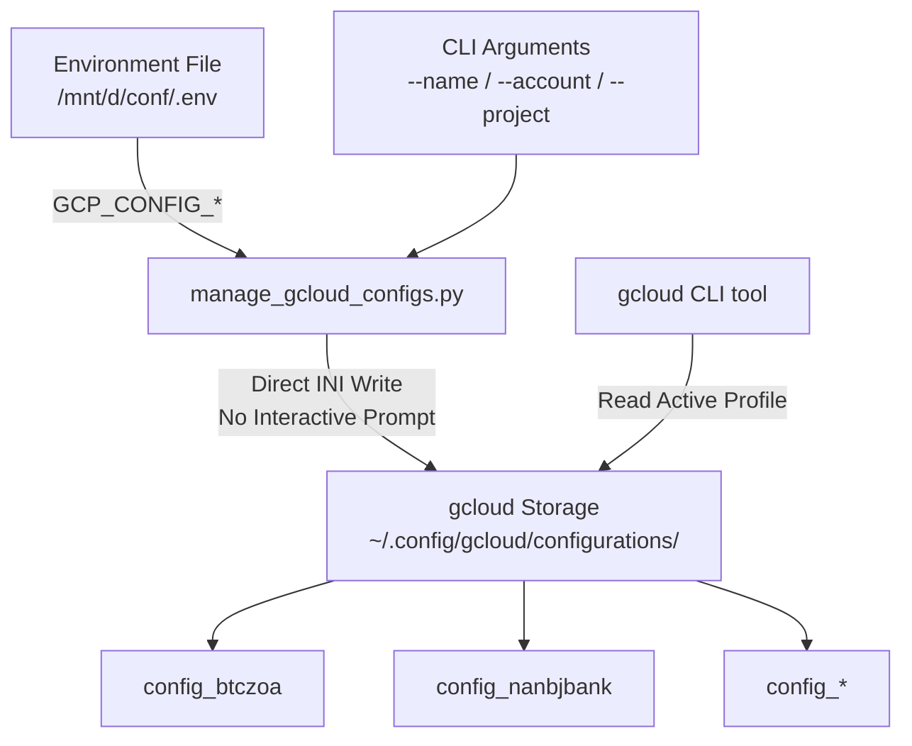

# Architecture: gcloud Multi-Account Management

## 1. Logical Architecture (Data Flow & Responsibility)

## 2. Infrastructure Architecture (File & Permission Boundaries)

- **Config Root:** `/home/<user>/.config/gcloud/configurations/`
- **Active Profile Pointer:** `/home/<user>/.config/gcloud/active_config`
- **Permissions:** User private (`0600` or `0644`), owned by workstation non-root user.
- **Network Boundaries:** Local filesystem operation; no external network egress required to write profiles.
