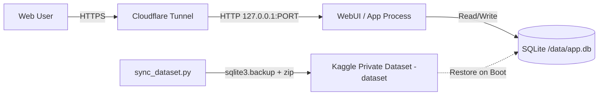
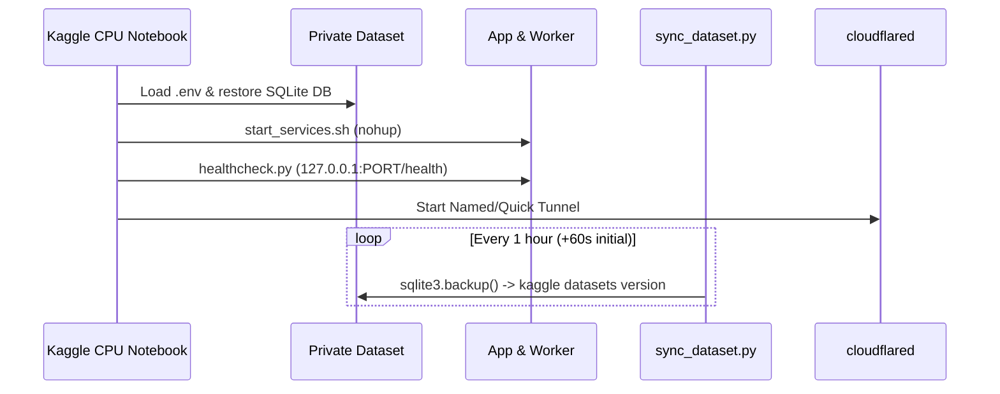

# Architecture & Specifications (`kaggle-app-hosting`)

## 1. Architecture Diagram

## 2. Sequence Diagram

## 3. Environment Variables, External Data & APIs
| Category | Name | Purpose |
|:---|:---|:---|
| **Env** | `TUNNEL_MODE`, `TUNNEL_HOST`, `TUNNEL_PORT`, `TUNNEL_HOSTNAME`, `TUNNEL_TOKEN` | Tunnel mode and binding |
| **Env** | `APP_REPO_URL`, `DB_PATH`, `DATASET_ID`, `KAGGLE_API_TOKEN` | App source, DB path, Private Dataset sync auth |
| **External Data** | Kaggle Private Dataset (`-dataset`), GitHub Public Repo | Persistent `.env`/DB and app source |
| **External API** | Kaggle Datasets API (`version -r zip`), Cloudflare Tunnel | Hourly backup and HTTPS ingress |

## 4. Deliverables
- `<app>_kaggle.ipynb`, `kernel-metadata.json`, `.env`, `.env.example`, `http.rest`, `README.html`
- `kaggle_private_dataset/{dataset-metadata.json, prepare_dataset.py, publish_kaggle_dataset.sh}`
