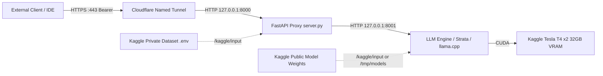
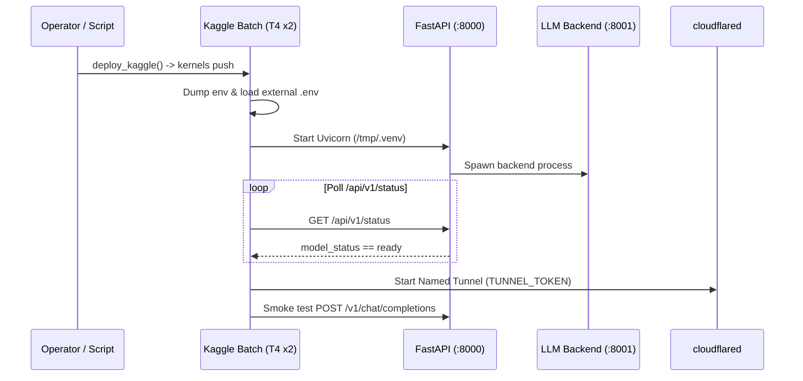

# Architecture & Specifications (`kaggle-notebook`)

## 1. Architecture Diagram

## 2. Sequence Diagram

## 3. Environment Variables, External Data & APIs
| Category | Name | Purpose |
|:---|:---|:---|
| **Env** | `TUNNEL_HOST`, `TUNNEL_PORT`, `TUNNEL_HOSTNAME`, `TUNNEL_TOKEN`, `LLM_API_KEY` | Network binding, Named Tunnel auth, Bearer auth |
| **Env** | `MODEL_NAME`, `HF_REPO_ID`, `VENV_DIR`, `MODELS_DIR` | Model ID and `/tmp/` isolation paths |
| **External Data** | `nanbingjun/<slug>-env-dataset`, `nanbingjun/<slug>-model` | Mounted `.env` and pre-published model weights |
| **External API** | Hugging Face Hub API (`/api/models/<repo>/tree/main`), Cloudflare Tunnel | Filename verification and HTTPS ingress |
| **Public API** | `GET /healthz`, `GET /api/v1/status`, `GET /v1/models`, `POST /v1/chat/completions` | Health, GPU/VRAM status, OpenAI-compatible inference |

## 4. Deliverables
- `<name>_kaggle.ipynb`, `kernel-metadata.json`, `.env`, `.env.example`, `http.rest`, `README.html`
- `kaggle_public_model/{download_model.py, model-metadata.json, model-instance-metadata.json, publish_kaggle_model.sh}`
- `kaggle_private_dataset/{dataset-metadata.json, prepare_dataset.py, publish_kaggle_dataset.sh}`
