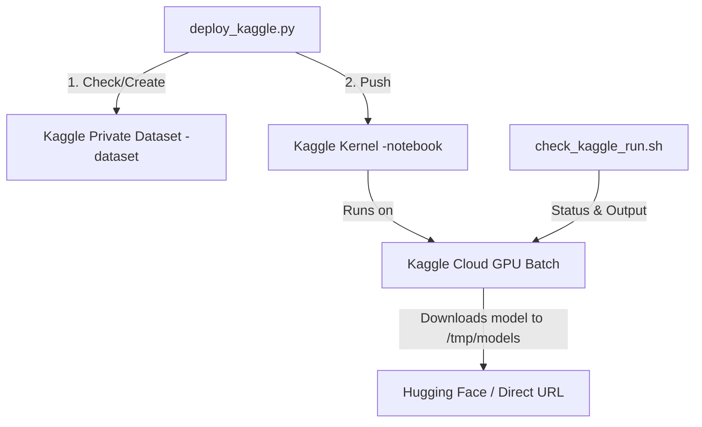
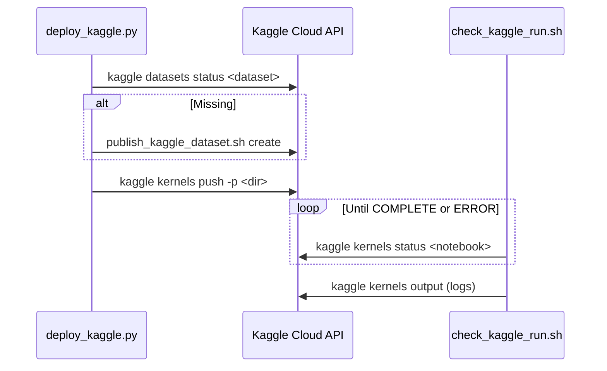

# Architecture & Specifications (`kaggle-operator`)

## 1. Architecture Diagram

## 2. Sequence Diagram

## 3. Environment Variables, External Data & APIs
| Category | Name | Purpose |
|:---|:---|:---|
| **Env** | `KAGGLE_API_TOKEN`, `HF_TOKEN` | Kaggle CLI auth and optional HF download auth |
| **External Data** | `kernel-metadata.json`, `dataset-metadata.json` | Resource IDs (`-notebook`, `-dataset`) |
| **External API** | Kaggle REST API (`datasets`, `kernels`) | Resource verification, creation, push, log retrieval |

## 4. Deliverables
- Deployed Kaggle Private Dataset (`-dataset`) and Notebook (`-notebook`)
- Downloaded execution logs (`<out_dir>/<slug>.log`, `logs/*.log`) and verified `http.rest` responses
