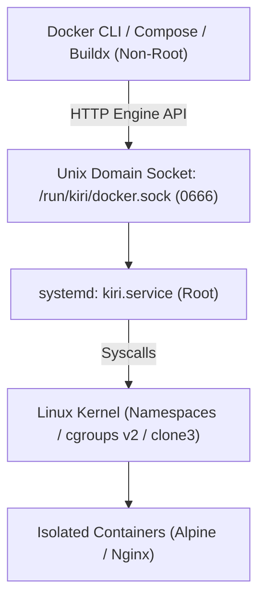

# ARCHITECTURE.md

## System Topology & Permissions Model

Kiri operates on Linux by interfacing directly with the Linux kernel (namespaces, cgroups, clone3) without an intermediary virtual machine layer.

## Key Configuration Paths
* **Kiri Binary:** `~/.local/bin/kiri`
* **Docker CLI:** `~/.local/bin/docker` -> `~/.local/libexec/kiri/bin/docker`
* **CLI Plugins:** `~/.docker/cli-plugins/{docker-compose, docker-buildx}`
* **Systemd Service:** `/etc/systemd/system/kiri.service`
* **Root Unix Socket:** `/run/kiri/docker.sock`
* **Docker Context:** `kiri` (`host=unix:///run/kiri/docker.sock`)
