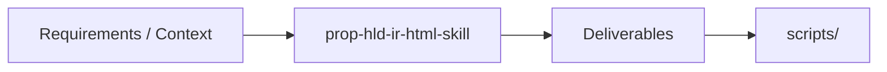
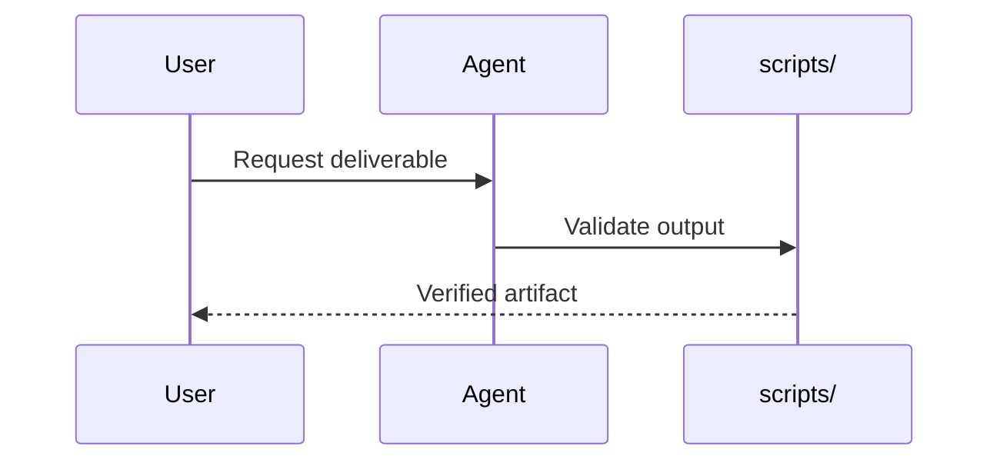

# Architecture & Specifications (`prop-hld-ir-html-skill`)

## 1. Architecture Diagram

## 2. Sequence Diagram

## 3. Environment Variables, External Data & APIs
| Category | Name | Purpose |
|:---|:---|:---|
| **Input** | Workspace files / specs | Source context for generation |

## 4. Deliverables
- Formal Proposal / HLD / Incident Report standalone HTML generator
