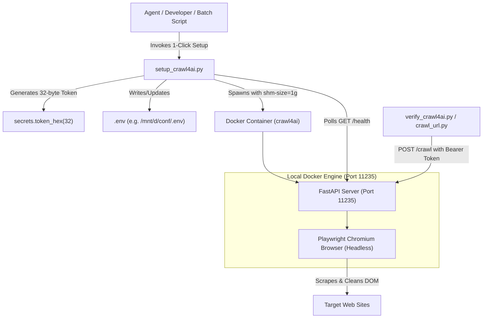
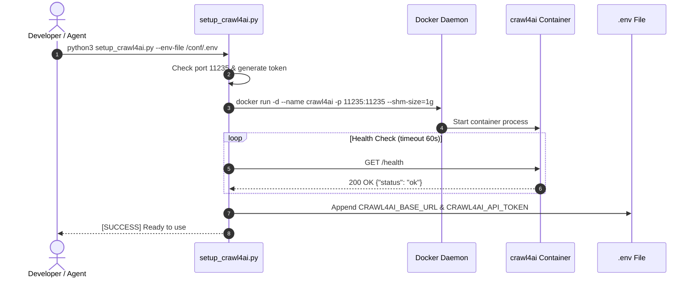

# setup-run-crawl4ai: Architecture & Specifications

## 1. Architecture Diagram

## 2. Sequence Diagram

## 3. Environment Variables & Deliverables

| Key | Purpose | Example |
|:---|:---|:---|
| `CRAWL4AI_BASE_URL` | Local container HTTP URL | `http://127.0.0.1:11235` |
| `CRAWL4AI_API_TOKEN` | Bearer authentication token | `027cbf51f3fe...` |
| `CRAWL4AI_PORT` | Host binding port | `11235` |
