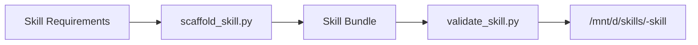
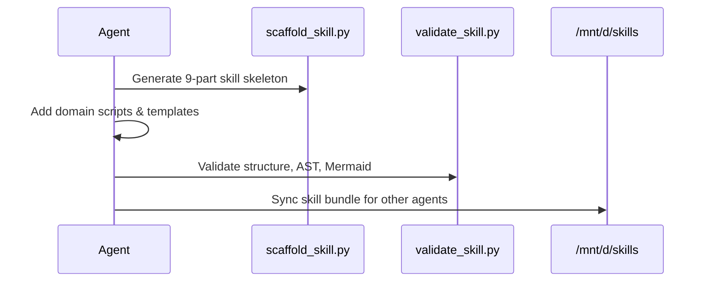

# Architecture & Specifications (`skill-architect`)

## 1. Architecture Diagram

## 2. Sequence Diagram

## 3. Environment Variables, External Data & APIs
| Category | Name | Purpose |
|:---|:---|:---|
| **Local Path** | `~/.gemini/antigravity-cli/skills/` | Active Antigravity skills directory |
| **External Path** | `/mnt/d/skills/<name>-skill/` | Shared external skill repository |

## 4. Deliverables
- Standardized skill directory (`SKILL.md`, `scripts/`, `prototype/`, `templates/`, `references/`)
- Synced external package in `/mnt/d/skills/<name>-skill/`
