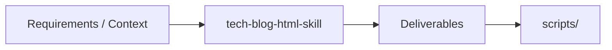
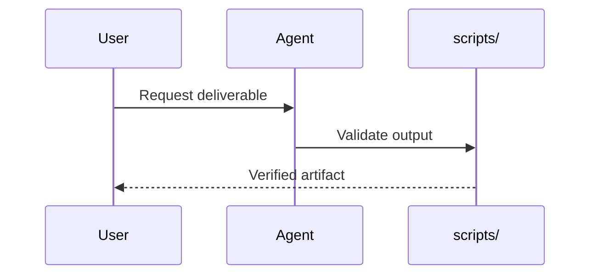

# Architecture & Specifications (`tech-blog-html-skill`)

## 1. Architecture Diagram

## 2. Sequence Diagram

## 3. Environment Variables, External Data & APIs
| Category | Name | Purpose |
|:---|:---|:---|
| **Input** | Workspace files / specs | Source context for generation |

## 4. Deliverables
- 9-block technical blog standalone HTML generator
