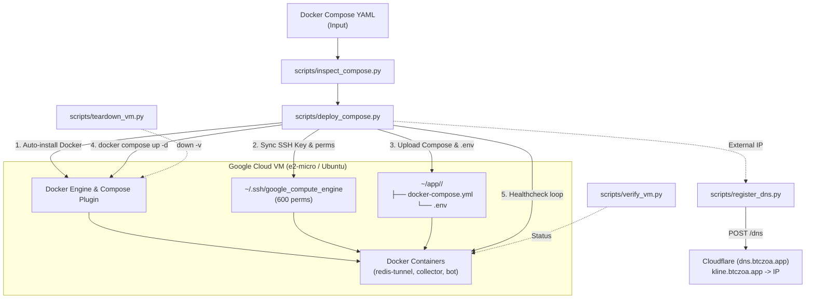
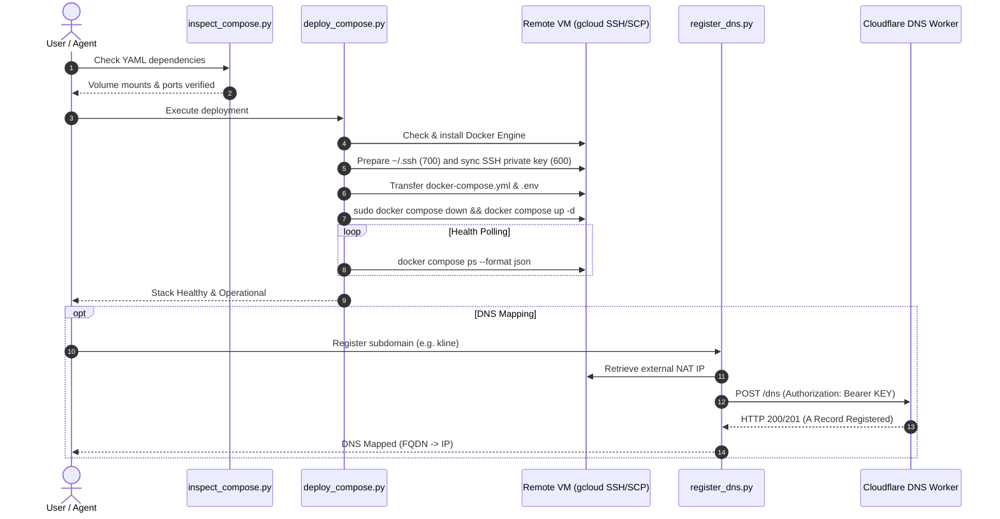

# Architecture & Specifications (`vm-docker-deploy`)

## 1. Architecture Diagram

## 2. Sequence Diagram

## 3. Environment Variables, External Data & APIs
| Category | Name | Purpose |
|:---|:---|:---|
| **CLI** | `gcloud` | Google Cloud CLI for transport (`ssh`, `scp`) and metadata query |
| **Auth** | `DNS_WORKER_API_KEY` | Read from `/mnt/d/.env.nan` for Cloudflare DNS registration |
| **API** | `https://dns.btczoa.app/dns` | REST endpoint for DNS A record management |
| **Auth** | `~/.ssh/google_compute_engine` | SSH private key used by containers for tunneling or host access |
| **Env** | `REDIS_SSH_KEY_PATH` | Host path mapped into containers (default: `~/.ssh/google_compute_engine`) |

## 4. Deliverables
- Fully running Docker container stack on target VM.
- Persistent configuration under `~/app/<service>/docker-compose.yml`.
- Standardized verification logs, health checks, and optional DNS A record.
