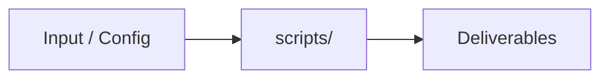
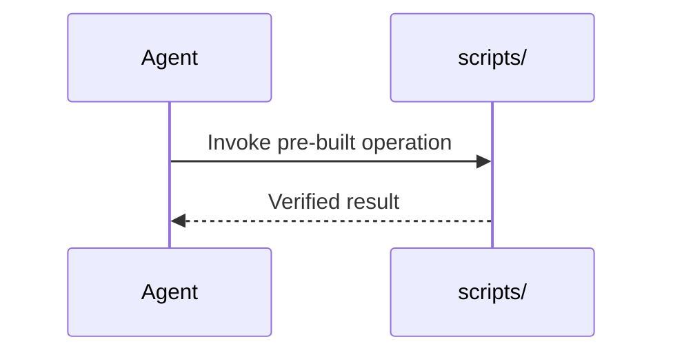

# Architecture & Specifications (`wiki-worker-publisher`)

## 1. Architecture Diagram

## 2. Sequence Diagram

## 3. Environment Variables, External Data & APIs
| Category | Name | Purpose |
|:---|:---|:---|
| **Env** | `EXAMPLE_VAR` | Example config |

## 4. Deliverables
- Standard output artifacts
